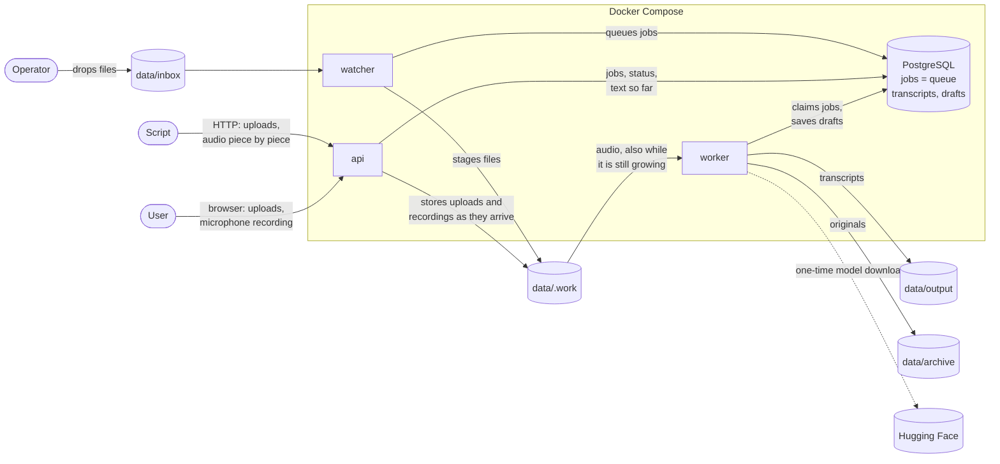
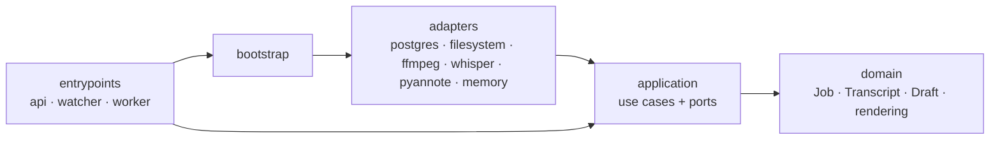
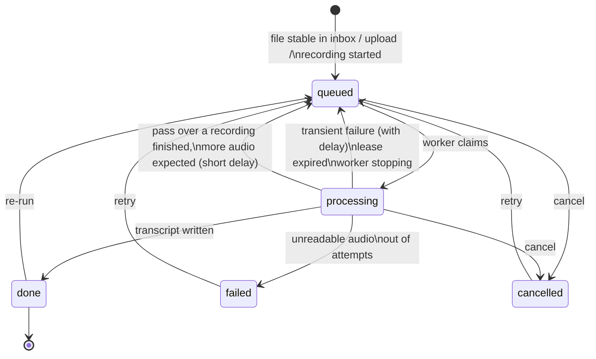
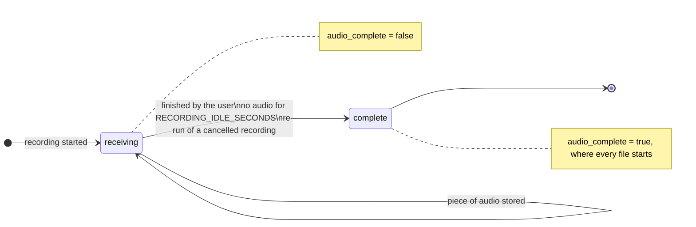

# Architecture

## System context



Audio reaches the system in three ways, and all three end as a job in the
same queue:

| Way in | Arrives | Becomes a job |
| --- | --- | --- |
| File dropped in the inbox | complete | once it has stopped changing |
| File uploaded through the page or API | complete | at once |
| Recording made in the page or sent through the API | piece by piece, over the length of the meeting | at its first second, so it is transcribed while it is recorded |

## Containers

| Service | Image | Role |
| --- | --- | --- |
| `db` | `postgres:17-alpine` | Stores every job. The `jobs` table is also the queue. |
| `watcher` | `audio-scribe-api` | Scans the inbox, queues stable files, reclaims jobs from dead workers, returns orphaned files. |
| `api` | `audio-scribe-api` | HTTP API and web page. Stores uploads, and recordings piece by piece while they are made. |
| `worker` | `audio-scribe-worker` | Loads Whisper and pyannote, processes one job at a time. Between other jobs it makes passes over recordings that are still going on. Can be scaled. |

`api` and `watcher` share a small image without any ML dependency. Only the
worker image carries PyTorch and the models; it is built for CPU or for CUDA
through a build argument. A third variant, `audio-scribe-worker-vulkan`, adds
whisper.cpp built with Vulkan. For Apple Metal the worker runs on the host
(`scripts/host-worker.sh`) against the same database and data folder.

All services mount the same `data/` folder. Models are cached in the `models`
volume, the database in the `db` volume.

## Layers

The code follows the dependency rule of Clean Architecture: source code only
depends on layers further in.



| Package | Contains | May import |
| --- | --- | --- |
| `scribe/domain` | `Job` and its state machine, `Transcript` and how it is built from words and speaker turns, `Draft` (the text of a recording so far), output rendering. Pure Python. | standard library |
| `scribe/application` | Use cases and the **ports** they need (`ports.py`): `InboxWatcher` (inbox to queue), `JobService` (uploads, recordings, everything the page and API offer), `JobProcessor` (one job, or one pass over a recording), `Worker`, `Housekeeper`. | domain |
| `scribe/adapters` | One implementation per port: PostgreSQL, local files, ffmpeg, faster-whisper, whisper.cpp, pyannote, plus an in-memory queue. | application, domain, third-party libraries |
| `scribe/bootstrap.py` | Composition root: decides which adapter fills which port. | everything |
| `scribe/entrypoints` | The three processes. Thin: parse input, call a use case, format output. | bootstrap, application, domain |

The rule is enforced by `tests/unit/test_architecture.py`, which fails the
build if, for example, a use case imports FastAPI or an adapter.

### Ports

| Port | Purpose | Adapters |
| --- | --- | --- |
| `JobRepository` | Durable job store and queue; also holds each transcript and the draft of each recording | `PostgresJobRepository`, `InMemoryJobRepository` |
| `WorkerRegistry` | What workers report about themselves | `PostgresWorkerRegistry`, `InMemoryWorkerRegistry` |
| `FileStore` | Inbox, staging (including recordings as they arrive), output, archive, failed | `LocalFileStore` |
| `AudioDecoder` | Any media file to 16 kHz mono samples, from a given second on | `FfmpegDecoder` |
| `SpeechRecognizer` | Samples to timed words | `WhisperRecognizer` |
| `Diarizer` | Samples to speaker turns | `PyannoteDiarizer` |
| `Clock` | Current time | `SystemClock` |

## Job life cycle



### Recordings

A recording is a job from its first second, so it moves through the states
above while its audio is still arriving. Whether more audio is expected is a
separate fact about the job (`audio_complete`), not a state of the queue:



The two combine as follows:

| Audio | What the worker does when it claims the job | The job then goes to |
| --- | --- | --- |
| receiving | One *pass*: transcribes what arrived since the last pass and saves it in the job's draft. | `queued`, runnable again in `RECORDING_PASS_SECONDS`. Not counted as an attempt. |
| complete | Transcribes what the draft does not cover yet (for a file: everything), identifies speakers over all of the audio, writes the transcript. | `done` |

While a recording is receiving, the page shows it as *recording* whatever its
queue state. A job that is cancelled, failed or deleted accepts no more
audio. How a pass decides which words to keep is described in the
[design](design.md#live-recording).

## Data folder

```
data/
  inbox/      drop audio here (sub-folders allowed)
  output/     transcripts, mirroring the inbox sub-folders; a recording
              made in the page is named "Recording <date> <time>"
  archive/    originals that were transcribed, recordings included
  failed/     originals that could not be, each with <name>.error.txt
  .work/      internal: <job id>/<file> while queued or processing;
              a recording grows here, piece by piece, until it has ended
```

## Key decisions

**Dedicated speech models, no LLM.** Whisper is an encoder–decoder speech
recogniser and pyannote a segmentation + speaker-embedding pipeline. Both run
locally; nothing generative post-processes the text.

**PostgreSQL is the queue.** The system needs a durable record of every job
anyway (status, history, transcript). Using the same table as the queue, with
`SELECT … FOR UPDATE SKIP LOCKED`, gives exactly-one-worker-per-job and
crash-safe state changes in a single transaction, with one less service to
run than a broker plus a database. Throughput is bounded by transcription
(seconds to minutes per job), so broker-grade message rates are irrelevant.

**Leases instead of acknowledgements.** A worker must keep renewing its claim.
This covers the failure a broker cannot see: a worker that is alive but hung.

**Polling the inbox instead of file events.** inotify events do not cross
Docker bind mounts on Windows, macOS or network shares. A two-second scan
works everywhere, and the "unchanged for N seconds" rule also solves
half-copied files.

**One data mount.** Inbox, staging, output and archive are on one file system,
so taking a file from the inbox is one atomic rename. It is also what lets
the worker read a recording that the API is still writing.

**A recording is an ordinary job with one extra fact.** It is not a new kind
of job or a new queue state: it is queued like a file, and only carries the
flag that more audio is coming. Everything built for jobs (leases, retries,
cancelling, crash recovery, the page) therefore applies to recordings
without a second code path, and a file is simply a job whose audio was
complete from the start.

**Two Whisper engines behind one port.** faster-whisper is the default: it
is the fastest on CPU and CUDA and has the most precise word timings, but it
supports nothing else. whisper.cpp covers Vulkan and Metal. `DEVICE` selects
the engine; both implement `SpeechRecognizer`, so nothing above the adapters
knows which one runs. whisper.cpp is run as a program per recording, like
ffmpeg, rather than linked in: a GPU driver crash then costs one attempt of
one job instead of the worker.

**A recording is transcribed in passes, not by a worker that waits.** The
worker takes the job, transcribes what has arrived, saves that, and puts the
job back in the queue for half a minute. The alternative, one worker holding
the job for the whole meeting, would block the queue for hours while idle
five sixths of the time. With passes other files run in between, a crash
loses one pass at most, and leases, retries and cancelling work as for any
job. The decision record is in [plans/live-recording.md](plans/live-recording.md).

**pyannote for diarization.** Best open accuracy; the price is a one-time
Hugging Face token. The `Diarizer` port keeps this replaceable.

**Rules in the domain, not in SQL.** The PostgreSQL adapter only locks, loads
and saves rows. Whether a failed job is retried or given up is decided by
`Job.fail`, which is unit-tested without a database.
