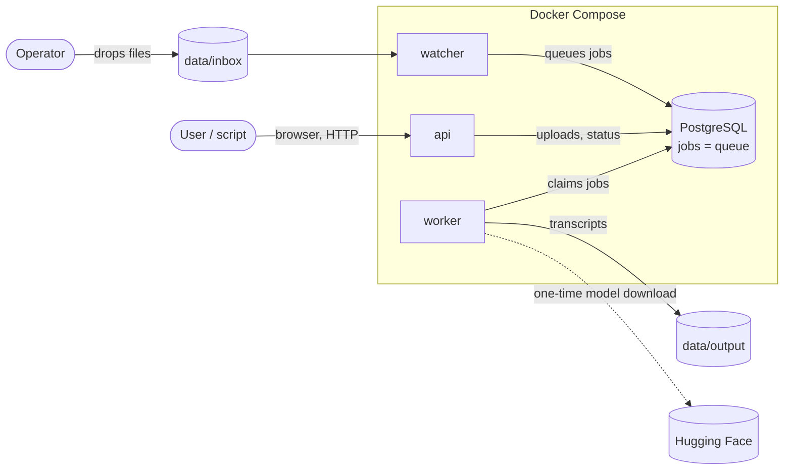
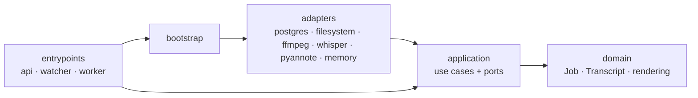
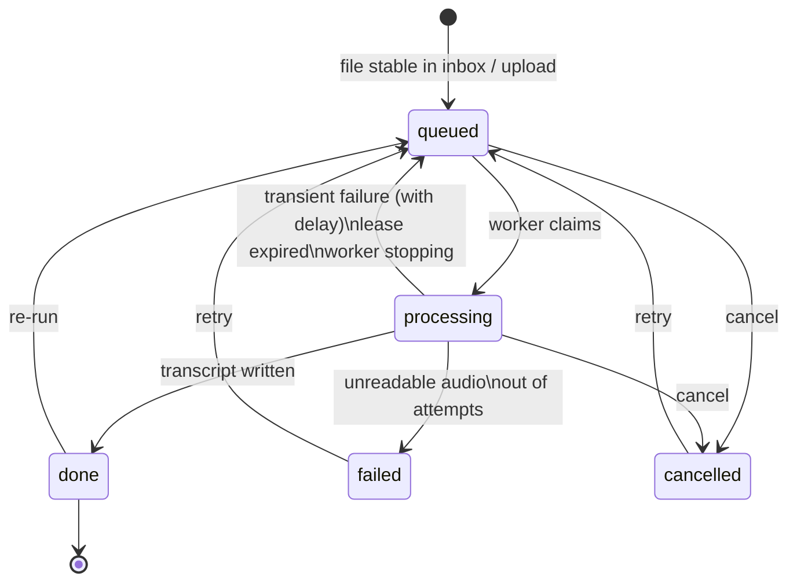

# Architecture

## System context



## Containers

| Service | Image | Role |
| --- | --- | --- |
| `db` | `postgres:17-alpine` | Stores every job. The `jobs` table is also the queue. |
| `watcher` | `audio-scribe-api` | Scans the inbox, queues stable files, reclaims jobs from dead workers, returns orphaned files. |
| `api` | `audio-scribe-api` | HTTP API and web page. |
| `worker` | `audio-scribe-worker` | Loads Whisper and pyannote, processes one job at a time. Can be scaled. |

`api` and `watcher` share a small image without any ML dependency. Only the
worker image carries PyTorch and the models; it is built for CPU or for CUDA
through a build argument. A third variant, `audio-scribe-worker-vulkan`, adds
whisper.cpp built with Vulkan. For Apple Metal the worker runs on the host
(`scripts/host-worker.sh`) against the same database and data folder.

All services mount the same `data/` folder. Models are cached in the `models`
volume, the database in the `db` volume.

## Layers

The code follows the dependency rule of Clean Architecture: source code only
depends on layers further in.



| Package | Contains | May import |
| --- | --- | --- |
| `scribe/domain` | `Job` and its state machine, `Transcript` and how it is built from words and speaker turns, output rendering. Pure Python. | standard library |
| `scribe/application` | Use cases (`InboxWatcher`, `JobProcessor`, `Worker`, `Housekeeper`, `JobService`) and the **ports** they need (`ports.py`). | domain |
| `scribe/adapters` | One implementation per port: PostgreSQL, local files, ffmpeg, faster-whisper, whisper.cpp, pyannote, plus an in-memory queue. | application, domain, third-party libraries |
| `scribe/bootstrap.py` | Composition root: decides which adapter fills which port. | everything |
| `scribe/entrypoints` | The three processes. Thin: parse input, call a use case, format output. | bootstrap, application, domain |

The rule is enforced by `tests/unit/test_architecture.py`, which fails the
build if, for example, a use case imports FastAPI or an adapter.

### Ports

| Port | Purpose | Adapters |
| --- | --- | --- |
| `JobRepository` | Durable job store and queue | `PostgresJobRepository`, `InMemoryJobRepository` |
| `WorkerRegistry` | What workers report about themselves | `PostgresWorkerRegistry`, `InMemoryWorkerRegistry` |
| `FileStore` | Inbox, staging, output, archive, failed | `LocalFileStore` |
| `AudioDecoder` | Any media file to 16 kHz mono samples | `FfmpegDecoder` |
| `SpeechRecognizer` | Samples to timed words | `WhisperRecognizer` |
| `Diarizer` | Samples to speaker turns | `PyannoteDiarizer` |
| `Clock` | Current time | `SystemClock` |

## Job life cycle



## Data folder

```
data/
  inbox/      drop audio here (sub-folders allowed)
  output/     transcripts, mirroring the inbox sub-folders
  archive/    originals that were transcribed
  failed/     originals that could not be, each with <name>.error.txt
  .work/      internal: <job id>/<file> while queued or processing
```

## Key decisions

**Dedicated speech models, no LLM.** Whisper is an encoder–decoder speech
recogniser and pyannote a segmentation + speaker-embedding pipeline. Both run
locally; nothing generative post-processes the text.

**PostgreSQL is the queue.** The system needs a durable record of every job
anyway (status, history, transcript). Using the same table as the queue, with
`SELECT … FOR UPDATE SKIP LOCKED`, gives exactly-one-worker-per-job and
crash-safe state changes in a single transaction, with one less service to
run than a broker plus a database. Throughput is bounded by transcription
(seconds to minutes per job), so broker-grade message rates are irrelevant.

**Leases instead of acknowledgements.** A worker must keep renewing its claim.
This covers the failure a broker cannot see: a worker that is alive but hung.

**Polling the inbox instead of file events.** inotify events do not cross
Docker bind mounts on Windows, macOS or network shares. A two-second scan
works everywhere, and the "unchanged for N seconds" rule also solves
half-copied files.

**One data mount.** Inbox, staging, output and archive are on one file system,
so taking a file from the inbox is one atomic rename.

**Two Whisper engines behind one port.** faster-whisper is the default: it
is the fastest on CPU and CUDA and has the most precise word timings, but it
supports nothing else. whisper.cpp covers Vulkan and Metal. `DEVICE` selects
the engine; both implement `SpeechRecognizer`, so nothing above the adapters
knows which one runs. whisper.cpp is run as a program per recording, like
ffmpeg, rather than linked in: a GPU driver crash then costs one attempt of
one job instead of the worker.

**pyannote for diarization.** Best open accuracy; the price is a one-time
Hugging Face token. The `Diarizer` port keeps this replaceable.

**Rules in the domain, not in SQL.** The PostgreSQL adapter only locks, loads
and saves rows. Whether a failed job is retried or given up is decided by
`Job.fail`, which is unit-tested without a database.
