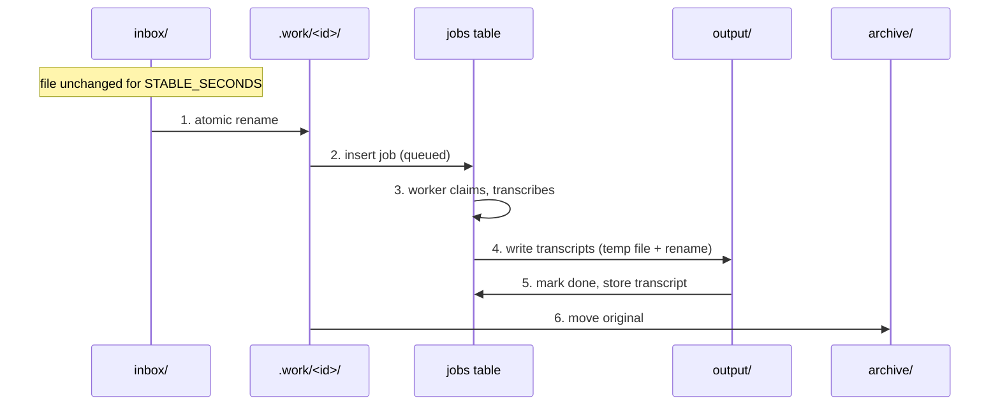
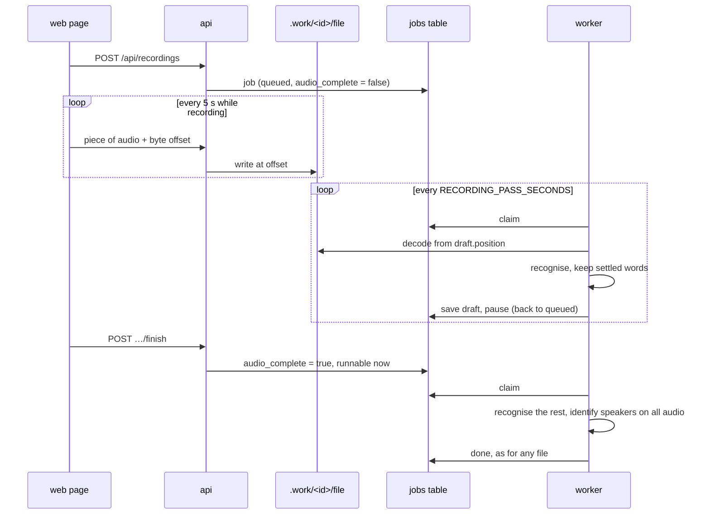

# Design

How the mechanisms described in the [architecture](architecture.md) work.

## Domain model

- **`Job`** (`domain/job.py`) — one audio file on its way to a transcript.
  Holds status, attempts, the lease (`locked_by`, `heartbeat_at`), `run_after`
  (earliest start, used for retry delays) and the result summary. Every state
  change is a method (`start`, `renew`, `complete`, `fail`, `release`,
  `expire_lease`, `cancel`, `retry`) that either applies the change or raises
  `InvalidTransition` / `NotOwner`.
- **`Draft`** (`domain/draft.py`) — what has been transcribed of a recording
  so far: the words, the second up to which they are settled, the language.
  `Draft.extended` decides which newly recognised words are kept.
- **`Transcript`** (`domain/transcript.py`) — language, duration, speakers and
  a list of `Segment`s (a paragraph by one speaker, made of timed `Word`s).
- **`render`** (`domain/rendering.py`) — a transcript as md, txt, json, srt or
  vtt.

## The queue

### Claiming

```sql
SELECT … FROM jobs
WHERE status = 'queued' AND run_after <= :now
ORDER BY created_at, id
FOR UPDATE SKIP LOCKED
LIMIT 1
```

In the same transaction the row is loaded into a `Job`, `job.start(worker)` is
applied, and it is saved. `SKIP LOCKED` makes concurrent workers pick
different rows without waiting. A contract test starts four threads against
real PostgreSQL and asserts twenty jobs are claimed exactly once each.

### Atomic updates

`JobRepository.update(job_id, mutate)` is the only way state changes:

1. `SELECT … FOR UPDATE` the row,
2. apply `mutate(job)` — a domain method,
3. save, commit.

If `mutate` raises, nothing is saved. Because worker actions check ownership
(`locked_by == worker` and `status == processing`), a worker that lost its job
cannot overwrite the work of the worker that now holds it.

### Leases and crash recovery

| Setting | Default | Meaning |
| --- | --- | --- |
| `HEARTBEAT_SECONDS` | 10 | How often a worker renews its lease |
| `LEASE_SECONDS` | 120 | Silence after which the job is taken back |

The worker renews from two places: the progress callbacks of the models, and
a timer thread (so a long model call that reports nothing still renews). The
watcher's housekeeper lists processing jobs with an old heartbeat and, under
the row lock, re-checks and calls `job.expire_lease`: back to `queued`, or
`failed` when the attempts are used up — which is what stops a file that
crashes the worker every time ("poison pill") from looping forever.

### Retries

`Job.fail(retryable=True)` re-queues with `run_after = now + backoff × 2^(attempt−1)`
(30 s, 60 s, … by default) until `MAX_ATTEMPTS`. Unreadable audio
(`UnreadableAudio` from the decoder) is not retryable and fails at once.

### Stopping and cancelling

- `docker compose stop` sends SIGTERM; the worker sets a flag, the next
  progress callback raises, and the job is **released** (back to `queued`,
  attempt not counted).
- Cancelling or deleting a running job makes the worker's next renewal raise
  `NotOwner`; it abandons the job and writes nothing.

### A worker that cannot start

If the models cannot be loaded (typically: no `HF_TOKEN`), the worker records
the reason in the `workers` table, claims nothing, and tries again every
minute. Jobs stay queued; the web page shows the reason.

## File handling



What a crash at each point leaves behind, and how it heals:

| Crash after | State | Recovery |
| --- | --- | --- |
| 1 | File in `.work`, no job | On start the watcher returns files without a job to the inbox |
| 2–4 | Job `processing`, file in `.work` | Lease expires, job is re-queued; transcripts are overwritten on the re-run |
| 5 | Job `done`, original still in `.work` | Harmless: transcript exists; re-run still possible |

The job is recorded as done *before* the original is moved, so no ordering of
failures can lose the audio.

Other rules:

- A transcript never overwrites another job's file: on a name clash the job
  id is appended (`call-1a2b3c4d.md`). Re-running a job overwrites its own.
- File names from uploads are reduced to their base name; sub-folder names are
  cleaned of `..`, so nothing is written outside the data folder.
- Files created by the containers are given the owner of the data folder, so
  they are not root-owned on the host.

## From audio to transcript

1. **Decode** — ffmpeg converts the first audio track to 16 kHz mono float
   samples. This is why every format ffmpeg knows is supported.
2. **Recognise** — faster-whisper with voice-activity detection and word
   timestamps. The language is detected from the audio unless given. On a GPU
   the batched pipeline is used. With `DEVICE=vulkan` or `metal` the
   whisper.cpp program does this step instead: the samples are handed over
   as a WAV file, progress is read from its log, and its sub-word tokens are
   joined into words. Its marker for silence (`[BLANK_AUDIO]`) is dropped.
3. **Diarize** — pyannote returns speaker turns (`start`, `end`, `label`). The
   *exclusive* output (no overlapping turns) is used when available. An
   expected number of speakers can be passed as a hint.
4. **Attribute** (`domain/transcript.py`) — each word goes to the speaker whose
   turns overlap it the most; a word in a gap takes the nearest turn. Labels
   are renamed "Speaker 1…N" in order of first appearance.
5. **Paragraphs** — consecutive words of one speaker form a segment; a
   monologue is additionally split at a sentence boundary after a pause of
   1.5 s or about 500 characters.
6. **Render** — one document per configured format; subtitle cues are cut at
   84 characters / 7 seconds and never span two speakers.

## Live recording



### Storing the audio

The browser's `MediaRecorder` produces one continuous file (WebM/Opus in
Chrome and Firefox) in pieces. The server appends them to one file in the
job's staging folder. Each piece comes with the byte offset it belongs at,
and is written *at* that offset under the job's row lock:

- sent twice (a retry after a lost answer): the same bytes land on the same
  place, nothing changes;
- sent too early (a piece before it is missing): refused with `409` and the
  offset the server expects.

A file in this state has no index and may end in the middle of a packet.
ffmpeg decodes it up to the last complete packet, which an integration test
checks with files cut off at arbitrary bytes.

### A pass

1. Load the draft; decode the file from `draft.position` to its current end
   (`AudioDecoder.decode(path, start)`).
2. Recognise that audio. After the first pass the language found then is
   passed in, so it cannot flip between passes.
3. `Draft.extended` keeps the words up to the last boundary between two
   recogniser segments (roughly sentences) that lies at least five seconds
   before the end of the audio, and moves `position` into the pause after
   them. Everything later is recognised again in the next pass, with more
   context. Speech that runs for a minute without a segment boundary is cut
   between two words instead.
4. Save the draft and `pause` the job: back to `queued`, runnable in
   `RECORDING_PASS_SECONDS`, attempt not counted.

A pass that finds the file not decodable yet (only part of the header has
arrived) just pauses. Once the recording has ended, the same condition fails
the job like any unreadable file.

### The end

`finish` sets `audio_complete` and makes the job runnable at once. The next
pass is the last: nothing is held back, the whole file is decoded once more
for speaker identification, and words and turns are merged by the same
`build_transcript` as for a file. An ordinary file takes this very path with
an empty draft, so there is one pipeline, not two.

If no audio arrives for `RECORDING_IDLE_SECONDS`, the next pass ends the
recording itself. The web page keeps the recording in memory until the server
has confirmed all of it, and offers it as a download if the server refuses a
piece (job cancelled or deleted) or stays unreachable.

### What a failure leaves behind

| Failure | Result |
| --- | --- |
| Worker crashes during a pass | Lease expires, job re-queued; the next pass resumes from the saved draft. Counts as an attempt, so a recording that crashes every pass is failed in the end. |
| Worker stopped during a pass | Job released; nothing lost but that pass. |
| No worker, or a long queue | Audio keeps being stored. The recording is transcribed later, in fewer and larger passes. |
| Browser closed, connection lost | Recording ended after the idle time and transcribed. |
| Job cancelled or deleted while recording | Further pieces are refused; the page offers its copy as a download. |

## Testing strategy

| Level | Where | What it proves | Needs |
| --- | --- | --- | --- |
| Acceptance (Gherkin) | `tests/features`, steps in `tests/acceptance` | Each requirement, through the real use cases and a real data folder | fake clock, fake speech models, in-memory queue |
| Unit | `tests/unit` | Domain rules, settings, adapter translation logic, the dependency rule | nothing |
| Contract | `tests/contract` | In-memory and PostgreSQL repositories behave identically | PostgreSQL for one of the two runs |
| Integration | `tests/integration` | HTTP API, file-store safety, ffmpeg decoding of real files, the command-line contract with whisper.cpp (against a stand-in program) | ffmpeg |

The speech models are never loaded in tests; they sit behind ports and are
replaced by fakes that turn a small text "recording" into timed words and
speaker turns. The fake queue is trustworthy because it must pass the same
contract tests as the real one.

## Known limitations

- A whole recording is decoded into memory (about 230 MB per hour of audio).
- Live recording: every pass decodes the file from the beginning to reach
  its start position (cheap next to recognition, but it grows with the
  length of the recording); the text can differ slightly from transcribing
  the finished file in one go, because the recogniser sees less context per
  pass; speaker identification is not started early; only WebM/Opus
  recordings are covered by tests.
- Speakers are numbered per file; there is no recognition across files.
- Overlapping speech is attributed to one speaker.
- With whisper.cpp (Vulkan, Metal): word timings are less precise than with
  faster-whisper, there is no voice-activity detection, and the model is
  loaded again for every recording (a few seconds).
- Speaker identification is not accelerated under Vulkan.
- No authentication; the port is bound to localhost by default.
- Schema changes are applied with `CREATE … IF NOT EXISTS`; a schema change to
  an existing column would need a migration tool.
